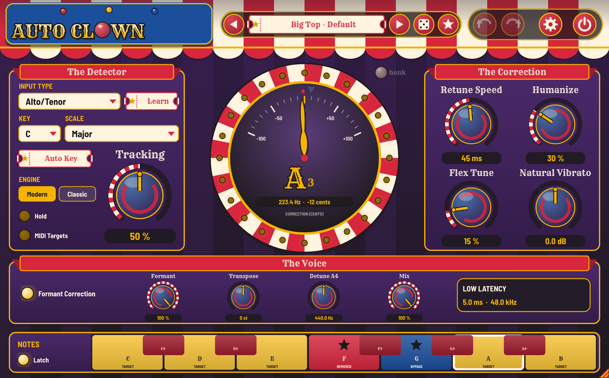

# 🎪 Auto Clown

Real-time pitch correction for macOS DAWs (VST3 + Audio Unit) with an original
vintage big-top look. Built with C++20, JUCE 9.0.5 and CMake.



## Features
* **Detector** — two-stage YIN with octave-error guards and voiced/unvoiced detection;
  Tracking control; 5 input ranges + **Learn**; Key/Scale (13 scales) + **Auto Key**.
* **Engines** — *Modern*: formant-preserving TD-PSOLA. *Classic*: pitch-synchronous
  delay-line shifter with vintage character. Unvoiced consonants pass through unshifted.
* **Correction** — Retune Speed (0–400 ms, 0 = hard tune), Flex Tune, Humanize,
  Natural Vibrato (±12 dB), Formant correction + amount, Transpose (±24 st), Detune
  (A4 = 410–470 Hz), Mix, Hold/Freeze.
* **Notes** — one-octave keyboard: Target (gold) / Bypass (blue) / Remove (red), Latch
  or momentary editing, **MIDI targets** (AU type `aumf`, VST3 event input).
* **Latency** — 5 ms (Low) or 30 ms (High Quality), reported via `setLatencySamples`.
* **UI** — freely resizable 50–200 % at a locked aspect ratio (striped corner handle and
  host resizing), size presets 75–200 %, size saved per session and as global default,
  all-vector drawing, 60 fps meter fed by a lock-free FIFO, presets with prev/next/
  randomise/save, undo/redo, bypass.
* **13 factory presets**, e.g. *Tightrope - Gentle Fix*, *Ringmaster - Natural Lead*,
  *Full Clown - Hard Tune*, *Trapeze Harmonies - Backing Vocals*, *Calliope - Robotic
  Organ*, *Stilt Walker - Octave Down Giant*, *Juggler - MIDI Targeted Lead* …

## Project structure
```
AutoClown/
├── CMakeLists.txt              # plugin, DSP lib, tests, tools; branding placeholders at top
├── src/
│   ├── dsp/                    # JUCE-free, real-time safe DSP core (unit-tested)
│   │   ├── DspUtils.h          #   ring buffers, biquads, smoothers, SPSC FIFO
│   │   ├── PitchDetector.*     #   two-stage YIN + octave guards + voicing
│   │   ├── ScaleMapper.*       #   key/scale/keyboard/MIDI -> targets, hysteresis
│   │   ├── RetuneEngine.*      #   retune glide, humanize, flex, vibrato, hold
│   │   ├── PsolaShifter.*      #   Modern engine (formant-preserving PSOLA)
│   │   ├── ClassicShifter.*    #   Classic engine (delay-line shifter)
│   │   ├── Analysis.*          #   Learn (range) and Auto Key
│   │   └── AutoClownEngine.*   #   full chain, latency, mix/bypass, meter FIFO
│   ├── plugin/                 # JUCE AudioProcessor, parameters, presets, settings
│   └── ui/                     # editor, LookAndFeel, logo, meter, keyboard, widgets
├── resources/fonts/            # Rye + Barlow Semi Condensed (SIL OFL, embedded)
├── tests/                      # 35 DSP tests, signal generators, CPU benchmark
├── tools/Snapshot.cpp          # renders the editor to PNG (docs/visual checks)
├── scripts/build_sign_notarize.sh  # universal build, tests, auval, pluginval, sign, notarize
└── docs/                       # DSP.md, CPU.md, HOST_TESTING.md, PHASE2_GRAPH_MODE.md
```

## Before you ship: replace the placeholders
In `CMakeLists.txt`: `AC_COMPANY_NAME`, `AC_COMPANY_WEBSITE`, `AC_BUNDLE_ID`,
`AC_MANUFACTURER_CODE` (4 chars, ≥ 1 upper-case), `AC_PLUGIN_CODE` (4 chars).
Mirror the codes in `scripts/build_sign_notarize.sh` (`AU_SUBTYPE`, `AU_MANUFACTURER`)
and the package identifier there.

## Build
macOS (universal, macOS 12+):
```bash
cmake -S . -B build -G Xcode -DCMAKE_OSX_ARCHITECTURES="arm64;x86_64"
```
```bash
cmake --build build --config Release
```
Release pipeline (build → tests → auval → pluginval 10 → sign → pkg → notarize → staple):
```bash
DEV_ID_APP="Developer ID Application: …" DEV_ID_INSTALLER="Developer ID Installer: …" NOTARY_PROFILE=AutoClownNotary ./scripts/build_sign_notarize.sh
```
DSP tests only (any OS, no JUCE download):
```bash
cmake -S . -B build-tests -DAUTOCLOWN_BUILD_PLUGIN=OFF && cmake --build build-tests && ./build-tests/tests/AutoClownTests
```
Options: `-DAUTOCLOWN_JUCE_PATH=/path/to/JUCE` (use a local checkout),
`-DAUTOCLOWN_STANDALONE=ON`, `-DAUTOCLOWN_BUILD_TOOLS=ON` (snapshot renderer).

## Status / verification
* 35/35 DSP unit tests pass (pitch accuracy, sweeps, octave traps, voicing, scale mapping,
  retune behaviours, both engines, formants, latency alignment, block-size independence,
  zero allocations in `process()`, stereo, MIDI, Learn, Auto Key).
* CPU: ≤ 2.4 % of one core in every configuration up to 192 kHz stereo — see `docs/CPU.md`.
* pluginval **strictness 10 passes** on the VST3 build (Linux, with editor tests).
* **Not yet done** (requires macOS hardware): AU build + `auval`, universal-binary build,
  signing/notarization run, and the DAW resize/host matrix in `docs/HOST_TESTING.md`.
  The release script automates the first three.

## Credits
Fonts: **Rye** © Sorkin Type, **Barlow Semi Condensed** © The Barlow Project Authors —
both SIL Open Font License 1.1 (license texts in `resources/fonts/`). All artwork is
original vector code.
